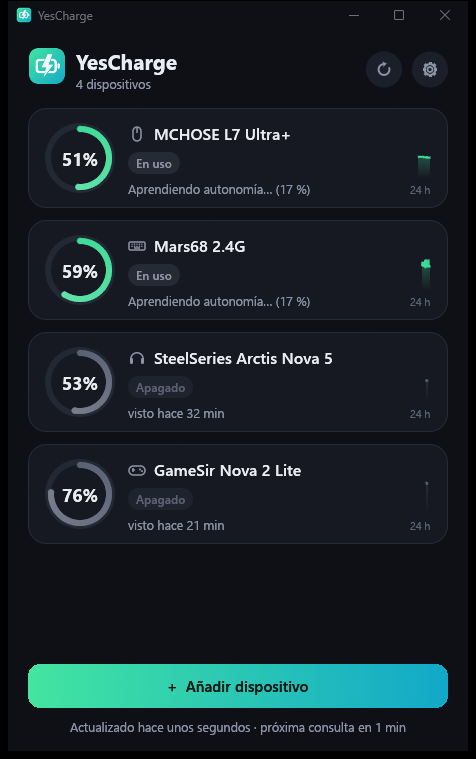

<div align="center">

# YesCharge

**Mira la batería de tus ratones, teclados, auriculares y mandos inalámbricos en la bandeja de Windows, sin tocar tus
dispositivos.**


[English](README.md) · **Español** · [Cambios por versión](CHANGELOG.es.md)



</div>

> [!WARNING]
> **Proyecto personal: úsalo bajo tu propio riesgo.** YesCharge se hizo para uso propio de su autor y se comparte tal
> cual, sin garantía. Puede que no funcione con tu dispositivo, y cualquier problema derivado de usarlo es responsabilidad
> tuya.
>
> **Beta.** La app, la bandeja y el motor de solo lectura funcionan, pero todavía se han probado muy pocos dispositivos
> (mira el [estado de las pruebas](#-estado-de-las-pruebas)). Si no consigue leer el tuyo, puedes abrir un *issue* con el
> informe que la app te guarda.

Eliges tu dispositivo de una lista y YesCharge lo prueba buscando una forma **segura** de leer su batería. Si la
encuentra, lo vigila desde la bandeja, te avisa cuando está bajo y cuando terminó de cargar, y aprende cuánto dura la
batería.

**Por defecto YesCharge solo lee.** Algunos modelos solo dicen su batería si se les pregunta: con esos puedes elegir que
YesCharge les pregunte. Esa opción viene apagada, es por dispositivo y hay que aceptar antes un aviso de riesgo.

## Contenido

- [Funciones](#-funciones)
- [Cómo lee la batería](#-cómo-lee-la-batería)
- [Cómo protege tus dispositivos](#%EF%B8%8F-cómo-protege-tus-dispositivos)
- [Estado de las pruebas](#-estado-de-las-pruebas)
- [Instalar](#-instalar)
- [Cómo se usa](#-cómo-se-usa)
- [Ajustes](#%EF%B8%8F-ajustes)
- [Preguntas frecuentes](#-preguntas-frecuentes)
- [Tecnología](#-tecnología)
- [Desarrollo](#-desarrollo)
- [Créditos](#-créditos)
- [Licencia y contribuciones](#-licencia-y-contribuciones)

---

## ✨ Funciones

- **Añade tu propio dispositivo** con un asistente: lo eliges, se prueba y confirmas que el porcentaje coincide con lo
  que ves.
- **Tu propio perfil escuchando**: para los dispositivos 2.4 GHz que Windows no conoce, YesCharge graba lo que el
  dispositivo envía mientras conectas y quitas el cable de carga, encuentra los bytes que cambian y le crea un perfil.
- **Preguntar, solo si lo aceptas**: a los modelos compatibles que solo dicen su batería si se les pregunta se les puede
  preguntar, tras un aviso de riesgo que debes aceptar. Mira la [lista de modelos](docs/protocol-sources.md#modelos-del-catálogo).
- **Envíanos tu dispositivo**: si no se puede leer el tuyo, el asistente guarda un informe que puedes adjuntar a un
  *issue* para añadir su modelo.
- **Icono en la bandeja** con el nivel más bajo, y un rayo mientras algo carga.
- **Avisos de Windows**: batería baja (se repite cada pocos minutos mientras siga baja) y "carga completa, ya puedes
  desconectarlo".
- **Margen de carga**: al llegar al 100 % sigue mostrando "cargando" los minutos que elijas antes de decir que está
  completo.
- **Autonomía aprendida**: mide cuánto dura cada 10 % y estima el tiempo que queda.
- **Historial de 24 horas y 7 días** de cada dispositivo, y el tiempo que falta para cargar cuando se puede estimar.
- **La lista se ordena sola**, con lo encendido primero, o se queda en el orden que elijas: arrastra un dispositivo para
  moverlo.
- **No despierta tus dispositivos**: mientras el PC está inactivo no lee nada.
- **Ligera**: un exe de unos 5 MB, sin runtime que instalar. La parte de la bandeja ocupa pocos MB de memoria; la
  ventana es un proceso aparte que solo existe mientras está abierta.
- **API local opcional** (desactivada por defecto) para pantallas externas.
- **En español e inglés**: empieza en español, y puedes cambiarlo en los ajustes.

## 🔋 Cómo lee la batería

Al elegir un dispositivo, YesCharge prueba estos métodos en orden. **Los tres primeros no envían nada al dispositivo.**

| # | Método | Para | Cómo |
|---|---|---|---|
| 1 | **Lo que Windows ya sabe** | Dispositivos Bluetooth y mandos compatibles con Xbox | Lee el valor de batería que Windows muestra en Configuración (Bluetooth) o da por XInput (4 niveles). |
| 2 | **Batería HID estándar** | Dispositivos que la declaran en su descriptor | Solo una lectura `GET_REPORT` del valor estándar *Battery Strength*, y solo si el propio dispositivo lo declara. |
| 3 | **Tu perfil de escucha** | Dispositivos 2.4 GHz que envían su estado por su cuenta | Escucha, en solo lectura, mientras conectas y quitas el cable y lo apagas y enciendes, y aprende dónde vienen la carga, el encendido y el porcentaje. |
| 4 | **Preguntar (opcional)** | Modelos de la lista comprobada de YesCharge | Envía la petición de estado exacta de ese modelo, solo después de aceptar un aviso de riesgo. |

Si ninguno funciona, la app guarda un **informe** (sin datos personales) y te ayuda a abrir un *issue* para pedir
soporte para ese modelo.

> [!NOTE]
> Muchos dispositivos 2.4 GHz solo dicen su batería **si se les pregunta**, y la pregunta es distinta en cada modelo.
> YesCharge solo les pregunta a los modelos de su lista comprobada, y nunca prueba comandos con un dispositivo desconocido.

## 🛡️ Cómo protege tus dispositivos

**Por defecto solo lee:**

- **Los dispositivos se abren sin permiso de escritura** (`GENERIC_READ`), así que Windows rechazaría cualquier intento
  de enviar algo. Editar el archivo de configuración no cambia eso.
- **Solo escucha las interfaces del fabricante** (páginas de uso `0xFF00`–`0xFFFF`), nunca las de teclado o ratón: tus
  pulsaciones y movimientos no se leen ni se guardan.
- **Sin permisos de administrador**, sin drivers, sin instalar nada en el sistema.
- **Sin telemetría ni actualizaciones automáticas.** La única conexión de red es la API local opcional, que solo
  escucha en `127.0.0.1`.

**Preguntar es opcional, y es la única excepción.** Todo está en un solo archivo, [`core/src/ask.rs`](core/src/ask.rs):

- Viene **apagado por defecto**, es por dispositivo y exige aceptar un aviso de riesgo.
- Solo envía **la petición de estado exacta de ese modelo**, incluida en el exe. Ningún archivo puede cambiarla.
- **Nunca prueba comandos** con un dispositivo que no esté en la lista, y nunca cambia un ajuste.
- Como mucho **una vez por minuto**, y nunca con el PC inactivo. A los modelos que no avisan por su cuenta se les
  pregunta a ese ritmo, porque es la única forma de notar el cable o que los apagaron.
- Tras **3 errores seguidos** deja de preguntar hasta que se lo indiques.

> [!CAUTION]
> Enviarle algo a un dispositivo nunca es 100 % seguro: con otro firmware podría comportarse distinto. Cada petición se
> comprobó en una sola unidad de ese modelo. Si no quieres ningún riesgo, no actives preguntar.

Más detalles en [SECURITY.md](SECURITY.md).

## 🧪 Estado de las pruebas

Lo que se ha probado hasta ahora en un PC real:

| Parte | Estado |
|---|---|
| Bandeja, avisos, ventana y ajustes | ✅ Funciona |
| Batería Bluetooth desde Windows | ✅ Leída bien en un dispositivo Bluetooth |
| Motor de escucha (apertura en solo lectura, captura, análisis) | ✅ Funciona; pruebas automáticas del análisis |
| Perfiles de escucha con dispositivos 2.4 GHz reales | ⚠️ Unos auriculares 2.4 GHz dieron su porcentaje, cable y encendido (con su software oficial abierto; sin probar con él cerrado). Un ratón 2.4 GHz da cable y enlace, pero **no** su porcentaje. Falta probar un teclado |
| Preguntar | ✅ Probado con los 4 modelos de la tabla de abajo; el cable y el apagado se comprobaron en cada uno |
| Mandos compatibles con Xbox (XInput) | ⚠️ Implementado, todavía sin probar con un mando |
| Batería HID estándar | ⚠️ Implementado, sin probar con un dispositivo que la declare |

Estos son los modelos a los que YesCharge puede preguntar, y lo que verás con cada uno:

| Modelo | Porcentaje | Cargando | Apagado | Cuando termina de cargar | Cuánto tarda en notarse un cambio |
|---|---|---|---|---|---|
| SteelSeries Arctis Nova 5 | Sí | Sí | Sí | Avisa al llegar al 100 % | Al momento (el número, cada 5 min) |
| MCHOSE L7 Ultra+ | Sí, sin cable | Sí | Sí | Avisa si el ratón dice que terminó | Al momento |
| Mars68 (CAROTMAS) | Sí; sube unos 13 puntos cerca del cable | Sí | "Dormido o apagado" | Avisa al llegar a 100, tras el margen | Hasta 1 min |
| GameSir Nova 2 Lite | Sí, sin cable | Sí | Sí | No se puede saber | Hasta 1 min |

El aviso de carga terminada todavía no se ha probado con una carga completa real.

Si lo pruebas con tu dispositivo, un *issue* diciendo si funcionó (y con qué método) ayuda mucho.

## 📦 Instalar

1. Descarga `YesCharge.exe` de [Releases](https://github.com/Yesid-Robayo/YesCharge/releases).
2. *(Recomendado)* Comprueba que es el archivo oficial. En PowerShell:
   ```powershell
   Get-FileHash .\YesCharge.exe -Algorithm SHA256
   ```
   Debe coincidir con el `SHA256SUMS.txt` de la release. Cada release la compila GitHub Actions a partir del código de
   este repositorio y lleva una [atestación de origen](https://docs.github.com/actions/security-for-github-actions/using-artifact-attestations)
   que puedes verificar con `gh attestation verify YesCharge.exe --repo Yesid-Robayo/YesCharge`.
3. Ponlo en la carpeta que quieras y ábrelo. No hay instalador.

> [!NOTE]
> El exe no está firmado con un certificado de pago, así que Windows SmartScreen puede avisarte la primera vez. Elige
> **Más información → Ejecutar de todas formas** si el SHA256 coincide.

Para desinstalar: en los ajustes, pulsa **Desinstalar…**, elige si conservas tus datos y borra el exe.

## 🎮 Cómo se usa

1. Abre `YesCharge.exe`. La primera vez se abre el asistente **Añadir dispositivo**.
2. Enciende tu dispositivo y úsalo un momento para que esté despierto. Elígelo de la lista.
3. YesCharge prueba los métodos seguros. Si uno funciona, te muestra el porcentaje y te pregunta si coincide con lo que
   ves en el dispositivo o en su app oficial. Ponle un nombre y pulsa **Sí, añadir**.
4. Si hace falta **tu propio perfil**, enciéndelo, pulsa **Ya está encendido: empezar a escuchar** y sigue los cinco pasos (sin cable → conecta el
   cable → quítalo → apágalo → enciéndelo); después elige qué valor coincide con tu batería.
5. Si tu modelo se puede preguntar y aceptas el aviso de riesgo, el asistente sigue esos mismos cinco pasos y te dice qué
   notó. Tarda unos minutos, porque pregunta como mucho una vez por minuto. Los últimos pasos siguen solos.
6. Desde entonces vive en la **bandeja**: clic izquierdo abre un panel rápido con los niveles; clic derecho muestra esos
   mismos niveles y las opciones.

Cerrar la ventana no cierra YesCharge: sigue vigilando desde la bandeja. Para cerrarlo del todo: clic derecho en el
icono → **Salir**.

## ⚙️ Ajustes

| Ajuste | Qué hace |
|---|---|
| Idioma | Español (por defecto) o inglés. |
| Lista de dispositivos | Encendidos primero (por defecto) u orden fijo. Arrastrar un dispositivo lo mueve y pasa a orden fijo. |
| Batería baja / Carga completa | Activa o desactiva cada aviso. |
| Repetir el aviso de batería baja | Cada cuántos minutos te lo recuerda mientras siga baja. |
| Consultar la batería cada | 1, 2, 5, 10 o 15 minutos. A los dispositivos que no avisan por su cuenta se les pregunta cada minuto. |
| Reposo | Tras ese tiempo sin usar el PC, deja de consultar para no despertar tus dispositivos. |
| Iniciar con Windows | Desactivado por defecto. Arranca en la bandeja, sin abrir la ventana. |
| API local | Publica el estado en `http://127.0.0.1:<puerto>/v1/status` (y `/min`, un formato compacto). Desactivada por defecto. |

Cada dispositivo tiene además su propio umbral de batería baja y su margen de carga (en sus **Detalles**).

**Archivos:** todo se guarda en `%APPDATA%\YesCharge`: `config.json` (ajustes y dispositivos), `status.json` (último
estado), `history.json` y `model.json` (historial y autonomía aprendida), `yescharge.log` (el log que se adjunta al
avisar de un error) y `captures\` (informes de escucha).

## ❓ Preguntas frecuentes

**¿Es portable?** Sí. Es un solo exe sin instalador: ponlo donde quieras. Tus ajustes se guardan en
`%APPDATA%\YesCharge`, salvo que pulses **Guardar los datos junto al exe** en los ajustes: entonces viajan con él, en una
carpeta `YesChargeData`.

**¿Y si tengo dos auriculares?** Funcionan los dos: añades cada uno y el encendido sale primero. Si son iguales, salen
numerados en el asistente. En los modelos que se detectan por su identificador USB, conectar uno puede marcar los dos como
cargando.

**¿Por qué tarda en cambiar?** Algunos modelos no avisan por su cuenta, así que YesCharge les pregunta cada minuto. Un
cambio puede tardar hasta un minuto en verse.

**¿Qué significa "Dormido o apagado"?** Que el dispositivo no responde. Muchos receptores no distinguen entre los dos, así
que la app no afirma ninguno.

**¿Qué significa "Último dato"?** Es lo último que se supo del dispositivo: no ha dicho nada nuevo, o el PC lleva un rato
sin usarse y no se le pregunta, para no despertarlo.

**¿Por qué dice "Cargando" sin número?** Algunos modelos no dan su porcentaje actual por cable. Mostrar el último
engañaría, así que el número vuelve cuando lo desconectas.

**¿Por qué salta el porcentaje al conectarlo?** Algunos teclados lo calculan por el voltaje, y sube cerca del cable. Vuelve
a bajar al desconectarlo.

**¿Cómo sé que terminó de cargar?** Depende del modelo: mira la tabla del [estado de las pruebas](#-estado-de-las-pruebas).
Si la app no puede saberlo, mira la luz del dispositivo.

**¿Por qué no coincide exactamente con la app oficial?** Una diferencia de un punto o dos es normal: cada app redondea a
su manera.

**¿Gasta la batería de mis dispositivos?** Escuchar no gasta nada. Preguntar es una petición pequeña, como mucho una vez
por minuto, y nunca con el PC inactivo.

**Windows dice que protegió mi PC.** El exe no está firmado con un certificado de pago, así que Windows no lo reconoce. Si
el SHA256 coincide, elige **Más información → Ejecutar de todas formas**.

## 🔧 Tecnología

- **Rust**, un solo exe sin runtime. La parte de la bandeja usa directamente la API de Windows; la ventana usa
  [egui](https://github.com/emilk/egui) y es un proceso aparte que solo existe mientras está abierta.
- `hid.dll` + SetupAPI de Windows para HID; CfgMgr32 para la batería Bluetooth; XInput para mandos.
- Iconos dibujados por código (sin archivos de imagen): el icono del exe se genera al compilar.

El diseño está explicado en [docs/architecture.md](docs/architecture.md).

## 💻 Desarrollo

Requisitos: [Rust](https://rustup.rs) (stable, `x86_64-pc-windows-msvc`) y las Visual Studio Build Tools (C++).

```powershell
cargo run -p yescharge                         # servicio + ventana (depuración)
cargo run -p yescharge -- --window             # solo la ventana
cargo test                                     # pruebas
cargo clippy --all-targets -- -D warnings      # lint
cargo build --release                          # target\release\YesCharge.exe
```

Diagnóstico (solo lectura, como la app):

```powershell
cargo run -p yescharge-core --example diag -- scan                # interfaces HID, Bluetooth, XInput
cargo run -p yescharge-core --example diag -- candidates          # lo que mostraría el asistente
cargo run -p yescharge-core --example diag -- watch 120           # lo que envían los dispositivos, en vivo
```

`YESCHARGE_DATA_DIR` cambia la carpeta de datos (útil para probar sin tocar tu configuración real). En las compilaciones
de depuración, `YESCHARGE_DEMO_PAGE` (`detail`, `settings`, `probe`, `none`, `listen`, `review`, `empty`, `confirm`)
abre una pantalla con datos de ejemplo.

## 🙏 Créditos

- **[egui / eframe](https://github.com/emilk/egui)** (MIT o Apache-2.0), **[windows-sys](https://github.com/microsoft/windows-rs)**
  (MIT o Apache-2.0), **[serde](https://serde.rs)** (MIT o Apache-2.0) y el resto de crates que aparecen en
  [THIRD_PARTY_NOTICES.txt](THIRD_PARTY_NOTICES.txt).
- **YesCharge es un proyecto independiente**, sin relación con SteelSeries, MCHOSE, CAROTMAS, GameSir ni ninguna otra
  marca, ni respaldado por ellas. Sus nombres solo indican con qué dispositivos funciona, y pertenecen a sus dueños.
- **Aviso sobre IA:** esta app se desarrolló con ayuda de herramientas de IA.

---

## 📄 Licencia y contribuciones

- YesCharge tiene licencia **[MIT](LICENSE)**. Se ofrece **tal cual, sin ninguna garantía**, y se usa **bajo tu propio
  riesgo**.
- Es un proyecto personal, hecho para uso propio de su autor y compartido por si le sirve a alguien más: no hay
  compromiso de soporte, y los *issues* se responden cuando hay tiempo.
- **No se aceptan *pull requests*** (se cierran automáticamente). Los errores, las ideas y las peticiones de soporte
  para dispositivos nuevos van en un *issue*; mira [CONTRIBUTING.md](CONTRIBUTING.md).
- Los problemas de seguridad se avisan en privado: [SECURITY.md](SECURITY.md).
