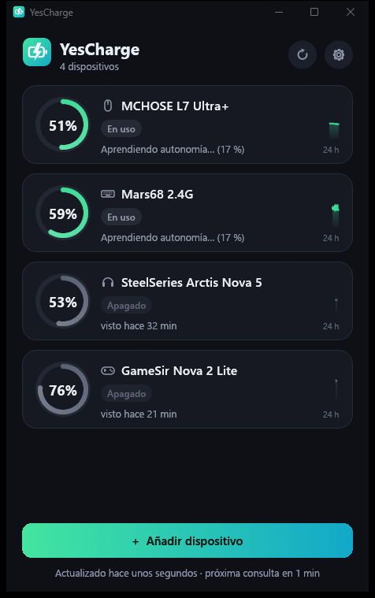

<div align="center">

# YesCharge

**See the battery of your wireless mice, keyboards, headsets and controllers in the Windows tray, without touching
your devices.**


**English** · [Español](README.es.md) · [Changelog](CHANGELOG.md)



</div>

> [!WARNING]
> **Personal project: use it at your own risk.** YesCharge was made for its author's own use and is shared as is, with no
> warranty. It may not work with your device, and any problem that comes from using it is your responsibility.
>
> **Beta.** The app, the tray and the read-only engine are working, but very few devices have been tried yet (see
> [Testing status](#-testing-status)). If yours can't be read, you can open an *issue* with the report the app saves for
> you.

You pick your device from a list and YesCharge tests it, looking for a **safe** way to read its battery. If it finds
one, it watches it from the tray, warns you when it's low and when it has finished charging, and learns how long the
battery lasts.

**By default YesCharge only reads.** Some models only tell their battery when asked: for those you can choose to let
YesCharge ask. That option is off, it's per device, and you have to accept a risk warning first.

## Contents

- [Features](#-features)
- [How it reads the battery](#-how-it-reads-the-battery)
- [How it protects your devices](#%EF%B8%8F-how-it-protects-your-devices)
- [Testing status](#-testing-status)
- [Install](#-install)
- [How to use it](#-how-to-use-it)
- [Settings](#%EF%B8%8F-settings)
- [FAQ](#-faq)
- [Technology](#-technology)
- [Development](#-development)
- [Credits](#-credits)
- [License and contributions](#-license-and-contributions)

---

## ✨ Features

- **Add your own device** with a wizard: choose it, test it and confirm that the percentage matches what you see.
- **Your own profile by listening**: for 2.4 GHz devices Windows doesn't know about, YesCharge records what the device
  sends while you plug and unplug the charging cable, finds the bytes that change and builds a profile for it.
- **Asking, only if you accept**: supported models that only tell their battery when asked can be asked, after a risk
  warning you must accept. See the [list of models](docs/protocol-sources.md#models-in-the-catalog).
- **Send us your device**: if yours can't be read, the wizard saves a report you can attach to an *issue* so its model
  can be added.
- **Tray icon** that shows the lowest battery level, with a bolt while something is charging.
- **Windows notifications**: low battery (repeated every few minutes while it stays low) and "fully charged, you can
  unplug it".
- **Top-off margin**: after reaching 100 %, it keeps showing "charging" for the minutes you choose before saying it's
  full.
- **Learned battery life**: it measures how long each 10 % lasts and estimates the time left.
- **History of 24 hours and 7 days** for each device, and the time left to charge when it can be estimated.
- **The list orders itself**, with what's on first, or stays in the order you choose: drag a device to move it.
- **Doesn't wake your devices**: while the PC is idle it doesn't read anything.
- **Light**: one ~5 MB exe, no runtime to install. The tray part uses a few MB of memory; the window is a separate
  process that only exists while it's open.
- **Optional local API** (off by default) for external screens.
- **Spanish and English**: it starts in Spanish, and you can change it in the settings.

## 🔋 How it reads the battery

When you pick a device, YesCharge tries these methods in order. **The first three send nothing to the device.**

| # | Method | For | How |
|---|---|---|---|
| 1 | **What Windows already knows** | Bluetooth devices and Xbox-compatible controllers | Reads the battery value Windows shows in Settings (Bluetooth) or gives through XInput (4 levels). |
| 2 | **Standard HID battery** | Devices that declare it in their descriptor | Only a `GET_REPORT` read of the standard *Battery Strength* value, and only if the device itself declares it. |
| 3 | **Your listening profile** | 2.4 GHz devices that send their status on their own | Listens, read-only, while you plug and unplug the cable and turn it off and on, and learns where the charge, the power state and the percentage are. |
| 4 | **Asking (optional)** | Models on YesCharge's verified list | Sends that model's exact status request, only after you accept a risk warning. |

If none of them works, the app saves a **report** (no personal data) and helps you open an *issue* to ask for support
for that model.

> [!NOTE]
> Many 2.4 GHz devices only tell their battery when **asked**, and the question is different for each model. YesCharge
> only asks models on its verified list, and never tries commands on an unknown device.

## 🛡️ How it protects your devices

**By default it only reads:**

- **Devices are opened without write permission** (`GENERIC_READ`), so Windows would reject any attempt to send
  something. Editing the configuration file can't change that.
- **It only listens to the manufacturer's interfaces** (usage pages `0xFF00`–`0xFFFF`), never the keyboard or mouse
  ones: your keystrokes and mouse movements are never read or saved.
- **No administrator rights**, no drivers, nothing installed in the system.
- **No telemetry and no automatic updates.** The only network connection is the optional local API, which listens on
  `127.0.0.1` only.

**Asking is optional, and it's the one exception.** All of it lives in one file, [`core/src/ask.rs`](core/src/ask.rs):

- It's **off by default**, per device, and it needs you to accept a risk warning.
- It only sends **that model's exact status request**, built into the exe. It can't be changed from any file.
- It **never tries commands** on a device that isn't on the list, and never changes a setting.
- At most **once a minute**, and never while the PC is idle. Models that give no notice of their own are asked at that
  pace, because it's the only way to notice the cable or that they were turned off.
- After **3 errors in a row** it stops asking until you tell it to resume.

> [!CAUTION]
> Sending anything to a device is never 100 % safe: with a different firmware it could behave differently. Each request
> was checked on a single unit of that model. If you want no risk at all, don't turn asking on.

More details in [SECURITY.md](SECURITY.md).

## 🧪 Testing status

What has been tried on a real PC so far:

| Part | Status |
|---|---|
| Tray, notifications, window and settings | ✅ Working |
| Bluetooth battery from Windows | ✅ Read correctly on a Bluetooth device |
| Listening engine (opening read-only, capture, analysis) | ✅ Working; automatic tests for the analysis |
| Listening profiles with real 2.4 GHz devices | ⚠️ A 2.4 GHz headset gave its percentage, cable and power state (with its official software open; not tried with it closed). A 2.4 GHz mouse gives cable and link, but **not** its percentage. A keyboard is still to be tried |
| Asking | ✅ Tried on the 4 models in the table below; the cable and power steps were checked on each one |
| Xbox-compatible controllers (XInput) | ⚠️ Implemented, not tried with a controller yet |
| Standard HID battery | ⚠️ Implemented, no device that declares it has been tried |

These are the models YesCharge can ask, and what you'll see with each one:

| Model | Percentage | Charging | Off | When charging ends | How fast a change shows |
|---|---|---|---|---|---|
| SteelSeries Arctis Nova 5 | Yes | Yes | Yes | Alerts on reaching 100 % | At once (the number, every 5 min) |
| MCHOSE L7 Ultra+ | Yes, without cable | Yes | Yes | Alerts if the mouse says it finished | At once |
| Mars68 (CAROTMAS) | Yes; rises about 13 points near the cable | Yes | "Asleep or off" | Alerts on reaching 100, after the margin | Up to 1 min |
| GameSir Nova 2 Lite | Yes, without cable | Yes | Yes | Can't be known | Up to 1 min |

The fully charged alert hasn't been tried with a real full charge yet.

If you try it with your device, an *issue* saying whether it worked (and which method it used) helps a lot.

## 📦 Install

1. Download `YesCharge.exe` from [Releases](https://github.com/Yesid-Robayo/YesCharge/releases).
2. *(Recommended)* Check that it's the official file. In PowerShell:
   ```powershell
   Get-FileHash .\YesCharge.exe -Algorithm SHA256
   ```
   It must match the `SHA256SUMS.txt` of the release. Every release is built by GitHub Actions from this repository's
   code and carries a [provenance attestation](https://docs.github.com/actions/security-for-github-actions/using-artifact-attestations)
   that you can verify with `gh attestation verify YesCharge.exe --repo Yesid-Robayo/YesCharge`.
3. Put it in a folder of your choice and open it. There is no installer.

> [!NOTE]
> The exe is not signed with a paid certificate, so Windows SmartScreen may warn you the first time. Choose **More
> info → Run anyway** if the SHA256 matches.

To uninstall: in the settings, press **Uninstall…**, choose whether to keep your data, and delete the exe.

## 🎮 How to use it

1. Open `YesCharge.exe`. The first time, the **Add device** wizard opens.
2. Turn on your device and use it for a moment so it's awake. Pick it from the list.
3. YesCharge tests the safe methods. If one works, it shows the percentage and asks you if it matches what you see on
   the device or in its official app. Give it a name and press **Yes, add it**.
4. If it needs **your own profile**, turn it on, press **It's already on: start listening** and follow the five steps
   (without cable → plug the cable → unplug it → turn it off → turn it on), then pick which value matches your battery.
5. If your model can be asked and you accept the risk warning, the wizard follows those same five steps and tells you
   what it noticed. It takes a few minutes, because it asks at most once a minute. The last steps continue on their own.
6. From then on it lives in the **tray**: left click opens a quick panel with the levels; right click shows the same
   levels and the options.

Closing the window doesn't close YesCharge: it keeps watching from the tray. To close it completely: right-click the
icon → **Quit**.

## ⚙️ Settings

| Setting | What it does |
|---|---|
| Language | Spanish (default) or English. |
| Device list | Turned on first (default) or fixed order. Dragging a device moves it and switches to fixed order. |
| Low battery / Fully charged | Turn each notification on or off. |
| Repeat the low battery alert | Every how many minutes it reminds you while the battery stays low. |
| Check the battery every | 1, 2, 5, 10 or 15 minutes. Devices that give no notice of their own are asked every minute. |
| Idle | After this long without using the PC, it stops reading so it doesn't wake your devices. |
| Start with Windows | Off by default. Starts in the tray, without opening the window. |
| Local API | Publishes the status on `http://127.0.0.1:<port>/v1/status` (and `/min`, a compact format). Off by default. |

Each device also has its own low battery threshold and top-off margin (in its **Details**).

**Files:** everything is kept in `%APPDATA%\YesCharge`: `config.json` (settings and devices), `status.json` (last
status), `history.json` and `model.json` (history and learned battery life), `yescharge.log` (the log to attach to a
bug report) and `captures\` (listening reports).

## ❓ FAQ

**Is it portable?** Yes. It's one exe with no installer: put it wherever you want. Your settings are kept in
`%APPDATA%\YesCharge`, unless you press **Keep the data next to the exe** in the settings: then they travel with it, in a
`YesChargeData` folder.

**What if I have two headsets?** Both work: you add each one, and the one that's on goes first. If they're identical they
show up numbered in the wizard. With models that are detected by their USB id, plugging one in can show both as charging.

**Why does it take a while to change?** Some models give no notice of their own, so YesCharge asks them every minute. A
change can take up to a minute to show.

**What does "Asleep or off" mean?** That the device isn't answering. Many receivers can't tell asleep from off, so the app
doesn't claim one or the other.

**What does "Last known" mean?** It's the last thing known about the device: it hasn't said anything new, or the PC has
been unused for a while and it isn't being asked, so as not to wake it.

**Why does it say "Charging" with no number?** Some models don't give a current percentage on the cable. Showing the last
one would be misleading, so the number comes back when you unplug it.

**Why does the percentage jump when I plug it in?** Some keyboards calculate it from the voltage, and it rises near the
cable. It goes back down when you unplug it.

**How do I know it finished charging?** It depends on the model: see the table in [Testing status](#-testing-status). If
the app can't know, check the light on the device.

**Why doesn't it exactly match the official app?** A difference of a point or two is normal: each app rounds in its own
way.

**Does it use up my devices' battery?** Listening doesn't use any. Asking is a small request, at most once a minute, and
never while the PC is idle.

**Windows says it protected my PC.** The exe isn't signed with a paid certificate, so Windows doesn't recognize it. If the
SHA256 matches, choose **More info → Run anyway**.

## 🔧 Technology

- **Rust**, a single exe with no runtime. The tray part uses the Windows API directly; the window uses
  [egui](https://github.com/emilk/egui) and is a separate process that only exists while it's open.
- Windows `hid.dll` + SetupAPI for HID; CfgMgr32 for the Bluetooth battery; XInput for controllers.
- Icons drawn in code (no image files): the exe icon is generated at build time.

The design is explained in [docs/architecture.md](docs/architecture.md).

## 💻 Development

Requirements: [Rust](https://rustup.rs) (stable, `x86_64-pc-windows-msvc`) and the Visual Studio Build Tools (C++).

```powershell
cargo run -p yescharge                         # service + window (debug)
cargo run -p yescharge -- --window             # window only
cargo test                                     # tests
cargo clippy --all-targets -- -D warnings      # lint
cargo build --release                          # target\release\YesCharge.exe
```

Diagnostics (read-only, like the app):

```powershell
cargo run -p yescharge-core --example diag -- scan                # HID interfaces, Bluetooth, XInput
cargo run -p yescharge-core --example diag -- candidates          # what the wizard would show
cargo run -p yescharge-core --example diag -- watch 120           # what the devices send, live
```

`YESCHARGE_DATA_DIR` changes the data folder (handy for trying things without touching your real configuration). In
debug builds, `YESCHARGE_DEMO_PAGE` (`detail`, `settings`, `probe`, `none`, `listen`, `review`, `empty`, `confirm`)
opens a screen with sample data.

## 🙏 Credits

- **[egui / eframe](https://github.com/emilk/egui)** (MIT or Apache-2.0), **[windows-sys](https://github.com/microsoft/windows-rs)**
  (MIT or Apache-2.0), **[serde](https://serde.rs)** (MIT or Apache-2.0) and the rest of the crates listed in
  [THIRD_PARTY_NOTICES.txt](THIRD_PARTY_NOTICES.txt).
- **YesCharge is an independent project**, not affiliated with or endorsed by SteelSeries, MCHOSE, CAROTMAS, GameSir or any
  other brand. Their names only say which devices it works with, and belong to their owners.
- **AI disclosure:** this app was developed with the help of AI tools.

---

## 📄 License and contributions

- YesCharge is licensed under the **[MIT License](LICENSE)**. It is provided **as is, without any warranty**, and you use
  it **at your own risk**.
- It's a personal project, made for its author's own use and shared in case it's useful to someone else: there's no
  support commitment, and *issues* get an answer when there's time.
- **Pull requests are not accepted** (they are closed automatically). Bugs, ideas and support requests for new devices
  go in an *issue*; see [CONTRIBUTING.md](CONTRIBUTING.md).
- Security problems are reported privately: [SECURITY.md](SECURITY.md).
